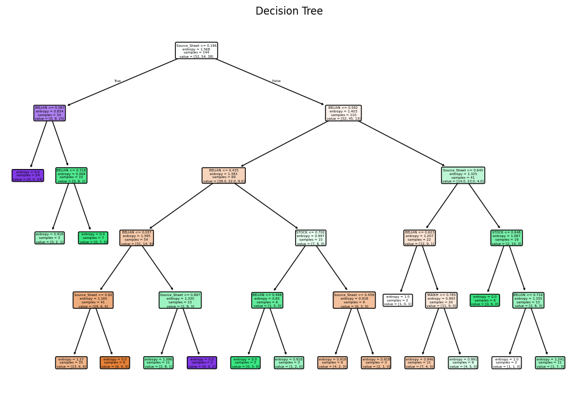
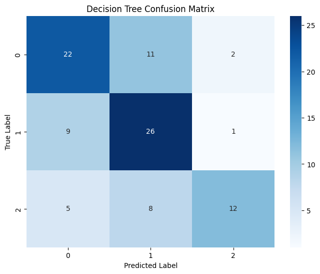
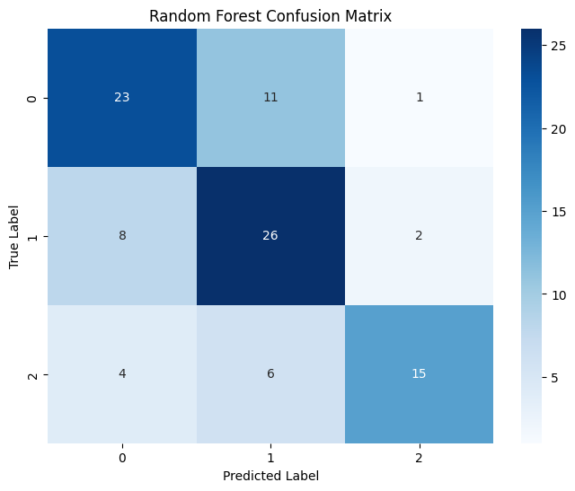
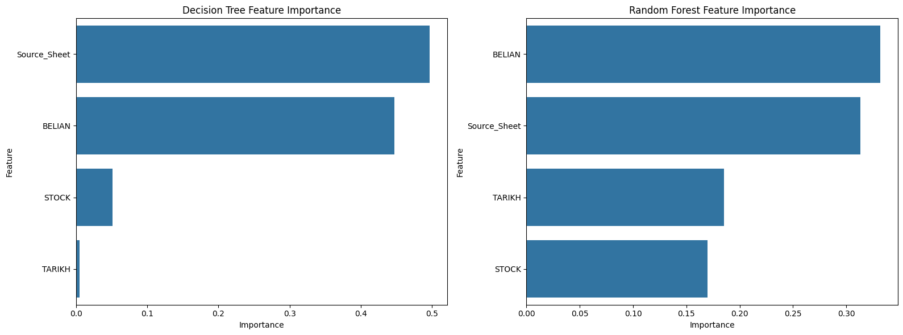
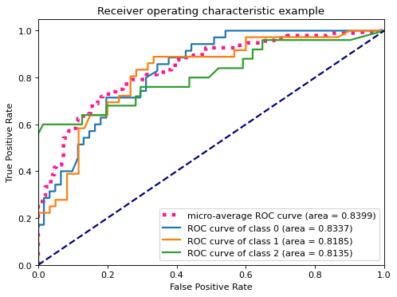
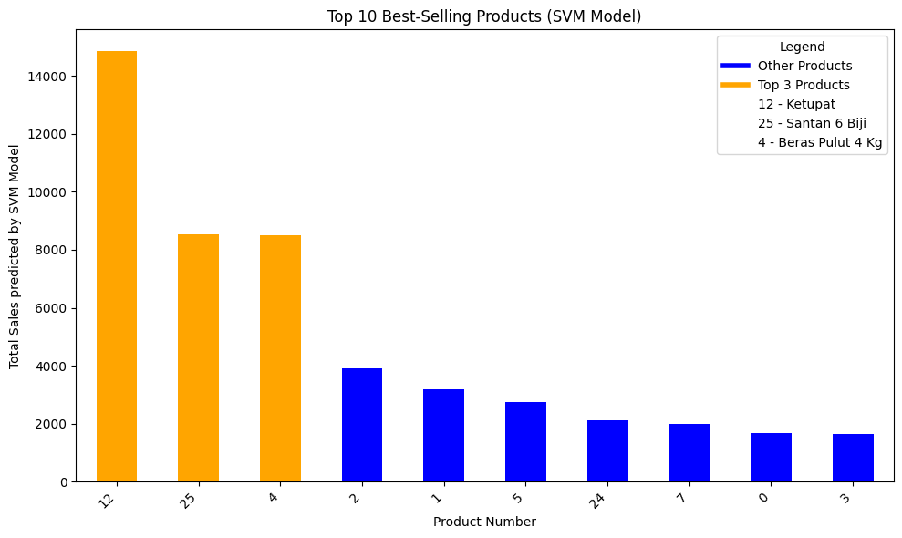

# SME Inventory and Sales Analysis

This project contains a notebook that explores historical SME sales and stock records using data preparation and machine-learning classification. It is an analysis example—not a production inventory system, a future-sales forecast, or a stock-ordering recommendation.

The original source workbook is private and is not included. The notebook and its saved analysis outputs are retained. The plots below are display copies of figures already saved in the notebook.

## Selected results

| Decision tree confusion matrix | Random forest confusion matrix |
|---|---|
|  |  |

| ROC curves | SVM product classification |
|---|---|
|  |  |

Confusion matrices show correct and incorrect classifications; feature importance describes how tree models used their inputs and does not establish cause and effect. These saved plots are snapshots from a prior run. The notebook includes additional saved cell outputs and the code that generated the analysis.

## Project files

- [`ITS69304_14_DATA_ANALYTICS_SME_DATA.ipynb`](ITS69304_14_DATA_ANALYTICS_SME_DATA.ipynb) — notebook with the analysis code and saved outputs.
- [`images/`](images/) — plot copies displayed above.

## Run the notebook

Open the notebook in Google Colab, run cells in order, and upload an authorized copy of the source Excel workbook when prompted. A local Python environment needs `pandas`, `numpy`, `scikit-learn`, `matplotlib`, `seaborn`, and `openpyxl`; running outside Colab requires replacing its upload step with local file loading.

The workbook is excluded for data-protection reasons. Without authorized access to it, a fresh run cannot reproduce the data-dependent results shown in the saved outputs. Excel workbooks, CSV files, and files inside `data/` are excluded by `.gitignore` to help prevent accidental inclusion.

## Contributors

The notebook credits Muhammad Shabir, Syed Athif, and Ali Danial for code contributions.
